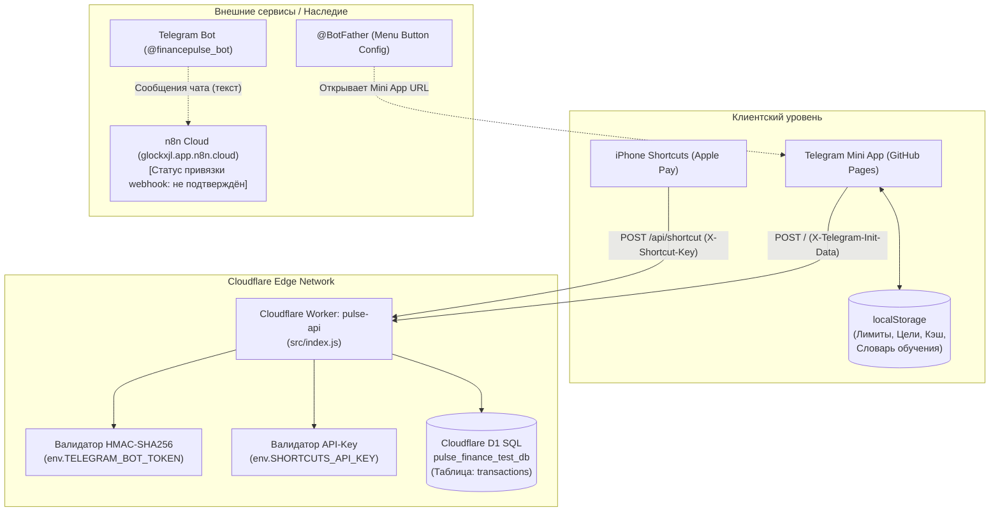

# Реальная архитектура и паспорт системы PULSE

> **Статус документа:** Актуальный единый источник правды (Single Source of Truth) о работающей системе PULSE.  
> **Дата актуализации:** 17 ноября 2026 г.  
> **Ограничение:** Не содержит конфиденциальных данных (токены бота, секретные ключи API и сырые строки `initData` исключены).

---

## 1. Сквозной путь Mini App

```
Telegram WebApp Client (iOS / Android / Desktop)
   │
   ▼
1. GitHub Pages (Фронтенд)
   https://glockxjl.github.io/pulse-finance-mini-app/
   (index.html, styles.css, app.js)
   │
   │  HTTPS POST с заголовком X-Telegram-Init-Data
   ▼
2. Cloudflare Worker (Backend API)
   https://pulse-api.dragonfantom2007.workers.dev
   (cloudflare-worker/src/index.js)
   │
   │  SQL-привязка env.DB
   ▼
3. Cloudflare D1 Database (Хранилище)
   pulse_finance_test_db (UUID: 63c29556-1d7e-40d1-9e2d-5f2f76ad69b9)
   Таблица: transactions
```

### Где проверяется доступ
- **Место проверки:** Cloudflare Worker (`cloudflare-worker/src/index.js`, функция `verifyTelegramInitData`).
- **Алгоритм:** Строгая криптографическая проверка подписи Web Crypto HMAC-SHA256:
  1. Вычисляется производный ключ: `HMAC-SHA256("WebAppData", env.TELEGRAM_BOT_TOKEN)`.
  2. Формируется строка проверки из параметров `initData` (за исключением поля `hash`), отсортированных по алфавиту в формате `key=value\n`.
  3. Сравнивается вычисленный HMAC-хэш с переданным в параметре `hash`.
  4. Проверяется срок жизни подписи: параметр `auth_date` не должен быть старше 24 часов (защита от атак повторного воспроизведения).
  5. Проверяется идентификатор владельца: `user.id === 1604405483` (`ALLOWED_OWNER_ID`). Запросы от посторонних аккаунтов отклоняются.
- При отсутствии или невалидности заголовка Worker возвращает `HTTP 403 Forbidden`.

### Где хранятся операции
- **База данных:** Cloudflare D1 `pulse_finance_test_db` (серверный регистр EEUR/FRA).
- **Основная рабочая таблица:** `transactions`.
  - Поля: `id` (INTEGER PK), `date` (TEXT, YYYY-MM-DD), `type` (TEXT: `income`/`expense`), `amount` (REAL), `category` (TEXT), `description` (TEXT), `externalId` (TEXT UNIQUE), `userId` (TEXT), `createdAt` (DATETIME).
- **Архивная таблица:** `expenses` (сохранена для совместимости из ранней версии, 3 записи). Все новые операции Mini App и Shortcuts записываются исключительно в `transactions`.

---

## 2. Маршрутизация сообщений текстового бота и связь с n8n

| Параметр | Фактическое состояние |
|---|---|
| **Маршруты бота в Cloudflare Worker** | **Отключены.** Маршруты `/telegram-webhook` и `/webhook/telegram` возвращают аппаратный `HTTP 404` (`Route disabled`), не читают и не пишут в D1. |
| **Управление кнопкой меню (`/admin/menu-button`)** | **Удалено.** Небезопасный вызов Telegram API из Worker устранён. Меню настраивается штатно через `@BotFather`. |
| **Связь с n8n Cloud** | **Не подтверждено (не проверено в реальном времени).** Исторически бот работал через n8n Cloud (`glockxjl.app.n8n.cloud`, workflow `My workflow`, ID `FxaYM9ga22Ug5gQR`, таблица `Expenses`). Переключение боевого webhook на Worker было отменено, поэтому предположительно бот остаётся привязан к n8n, однако точный адрес из `getWebhookInfo` в рамках текущей проверки не запрашивался, чтобы не компрометировать токен. |

---

## 3. Разделение данных: Устройство (localStorage) vs База (D1)

### Хранится только на устройстве (`localStorage` браузера):
1. **Режим приватности:** `finance_mini_app_privacy_v1` (скрывать или показывать суммы).
2. **Лимиты по категориям:** `finance_mini_app_cat_limits_v1` (месячные лимиты расходов).
3. **Цель накоплений:** `finance_mini_app_savings_goal_v1` (сумма цели, дата, название).
4. **Регулярные счета / подписки:** `finance_mini_app_bills_v1` (список регулярных платежей).
5. **Самообучающийся словарь мерчантов:** `finance_mini_app_learned_merchants_v1` (пользовательские сопоставления «продавец → категория», созданные при ручном изменении категории).
6. **Демо-операции:** `finance_mini_app_demo_tx_v2` (автономный набор операций для работы без Telegram).
7. **Локальный кэш операций:** `finance_mini_app_live_tx_v1` (кэшированный снимок последних полученных операций из API).
8. **Пользовательский URL API:** `finance_mini_app_api_url_v1` (ручное переопределение адреса API при отладке).

### Хранится на сервере в Cloudflare D1:
- Все реальные финансовые записи в таблице `transactions` (`id`, `date`, `type`, `amount`, `category`, `description`, `externalId`, `userId`, `createdAt`, `updatedAt`).
- Поддерживаемые действия Mini App API (`POST /`):
  - `list` — чтение всех операций владельца.
  - `create` — создание операции со строгой серверной валидацией (тип `income`/`expense`, положительная конечная сумма до цента, реальная календарная дата `YYYY-MM-DD`, длина категории `<= 60`, описания `<= 250`) и идемпотентной защитой от дублей по `externalId` при повторной отправке после потери ответа.
  - `update` — редактирование ровно одной принадлежащей владельцу записи по `id` / `externalId` (при отсутствии записи возвращает `HTTP 404`, а не `ok: true`).
  - `delete` — удаление записи владельца с проверкой фактического числа удалённых строк (`deletedCount`; при отсутствии записи возвращает `HTTP 404`).
  - `bulk_import` — атомарная пакетная вставка выписки через `env.DB.batch()` с предварительной валидацией всех строк и возвратом реальных `insertedCount`, `skippedDuplicatesCount` и `withoutExternalIdCount`.

> [!NOTE]
> **Честный статус связи и локального кэша:**  
> В режиме работы с API операция считается созданной, изменённой или удалённой **только после подтверждения Worker**.  
> Индикатор статуса в шапке (`#modeBadgeText`) и баннер уведомлений (`#syncStatusNotice`) различают 5 состояний:
> 1. `DEMO` — автономный демо-режим без обращений к серверу.
> 2. `Подключение…` — идёт первичный запрос к D1; если показан локальный кэш, выводится плашка «Пока отображается сохранённая на устройстве копия».
> 3. `Синхр. HH:MM` (зелёная точка) — подтверждён успешный ответ от Cloudflare Worker + D1.
> 4. `Нет связи • кэш` / `Нет связи` (красная точка) — ошибка сети или API; сохранённый список не стирается, но явно помечается как сохранённая копия, которая может быть устаревшей.
> 5. `Нужен вход TG` — задан URL API, но приложение открыто вне Telegram (отсутствует `initData`).

### Правила расчёта финансовых показателей:
- **Заголовок периода:** формируется динамически по текущей дате и выбранному фильтру (`7Д`, `МЕС`, `ВСЕ`, произвольные даты) без жёстко зашитого месяца.
- **Разделение итогов:** в главной карточке отдельно отображается итог (`Доходы − Расходы`) **за выбранный период** и справочная строка **по всем учтённым операциям в базе** (с явной пометкой, что это оценка по записям, а не банковский баланс Swedbank).
- **Оценка «Можно тратить сегодня» (`dailySafe`):** рассчитывается строго по **текущему календарному месяцу (`YYYY-MM`)** и не меняется при переключении фильтра истории (`7Д`/`ВСЕ`/`custom`). Формула: `(Доходы тек. месяца − Расходы тек. месяца − План копилки − Неоплаченные счета тек. месяца) ÷ Оставшиеся дни месяца (включая сегодня)`. При нулевом или отрицательном свободном остатке равна `€0.00`.
- **Обязательные счета месяца:** отметка об оплате привязана к конкретному месяцу (`paidMonth: "YYYY-MM"`) и автоматически сбрасывается при наступлении нового месяца.

---

## 4. Маршрут для iPhone Shortcuts (Apple Pay)

> [!NOTE]
> **Текущий статус:** Маршрут `/api/shortcut` полностью реализован на сервере Cloudflare Worker. Однако клиентский сценарий команды iPhone Shortcut в iOS на данный момент **отложен**, и сквозной боевой сценарий отправки оплат с iPhone **не принят**. В Mini App сохранена локальная симуляция.

- **Эндпоинт:** `POST https://pulse-api.dragonfantom2007.workers.dev/api/shortcut` (или `/shortcut`).
- **Авторизация:** Заголовок `X-Shortcut-Key` (сверяется с зашифрованным секретом `env.SHORTCUTS_API_KEY` в Cloudflare). Не требует Telegram `initData` и не использует небезопасный `testBypass`.
- **Защита данных на сервере:**
  - Валидация суммы: обязательна, число строго больше нуля (`> 0`).
  - Защита от дубликатов: по переданному `externalId`, либо автоматическая блокировка идентичных платежей (совпадение суммы, описания и даты) за последние 5 минут.
  - Автокатегоризация: применяется встроенный в Worker словарь литовских мерчантов (`autoCategorizeLT`).
  - Фиксация пользователя: операция принудительно привязывается к `userId = 1604405483`.
  - Изоляция таблиц: запись осуществляется строго в таблицу `transactions` (в архивную таблицу `expenses` не дублируется).

---

## 5. Схема компонентов



---

## 6. Реестр актуальных адресов и идентификаторов

| Компонент | Адрес / Идентификатор | Назначение |
|---|---|---|
| **Фронтенд Mini App** | `https://glockxjl.github.io/pulse-finance-mini-app/` | Публичный хостинг приложения на GitHub Pages |
| **Репозиторий GitHub** | `https://github.com/glockxjl/pulse-finance-mini-app` | Исходный код фронтенда и Worker |
| **Cloudflare Worker API** | `https://pulse-api.dragonfantom2007.workers.dev` | Серверный бэкенд (Mini App API + Shortcuts) |
| **Cloudflare D1 База** | `pulse_finance_test_db` (`63c29556-1d7e-40d1-9e2d-5f2f76ad69b9`) | Серверная база данных SQLite в Cloudflare |
| **Основная таблица D1** | `transactions` | Единый журнал доходов и расходов |
| **Telegram Bot** | `@financepulse_bot` | Чат-бот и точка запуска Mini App |
| **ID владельца в Telegram** | `1604405483` | Единственный разрешённый пользователь API (`ALLOWED_OWNER_ID`) |

---

## 7. Список ещё не подтверждённых зависимостей

1. **Текущий адрес Webhook у Telegram-бота:**  
   Точный URL, куда Telegram сейчас доставляет текстовые сообщения чата `@financepulse_bot`, достоверно **не подтверждён** в реальном времени (не опрашивался через `getWebhookInfo`). Требуется отдельная проверка без компрометации токена, если потребуется переносить текстовый бот на Cloudflare Worker.
2. **Работоспособность n8n Cloud:**  
   Состояние воркфлоу `My workflow` (`FxaYM9ga22Ug5gQR`) и таблицы `Expenses` в n8n Cloud в рамках текущей сессии не верифицировалось, так как весь контур Mini App уже полностью переведён на Cloudflare Workers + D1.
3. **Статус синхронизации лимитов и целей:**  
   Лимиты по категориям, цели накоплений и подписки в текущей версии хранятся локально в браузере клиента (`localStorage`) и не синхронизируются между разными устройствами через Cloudflare D1.
